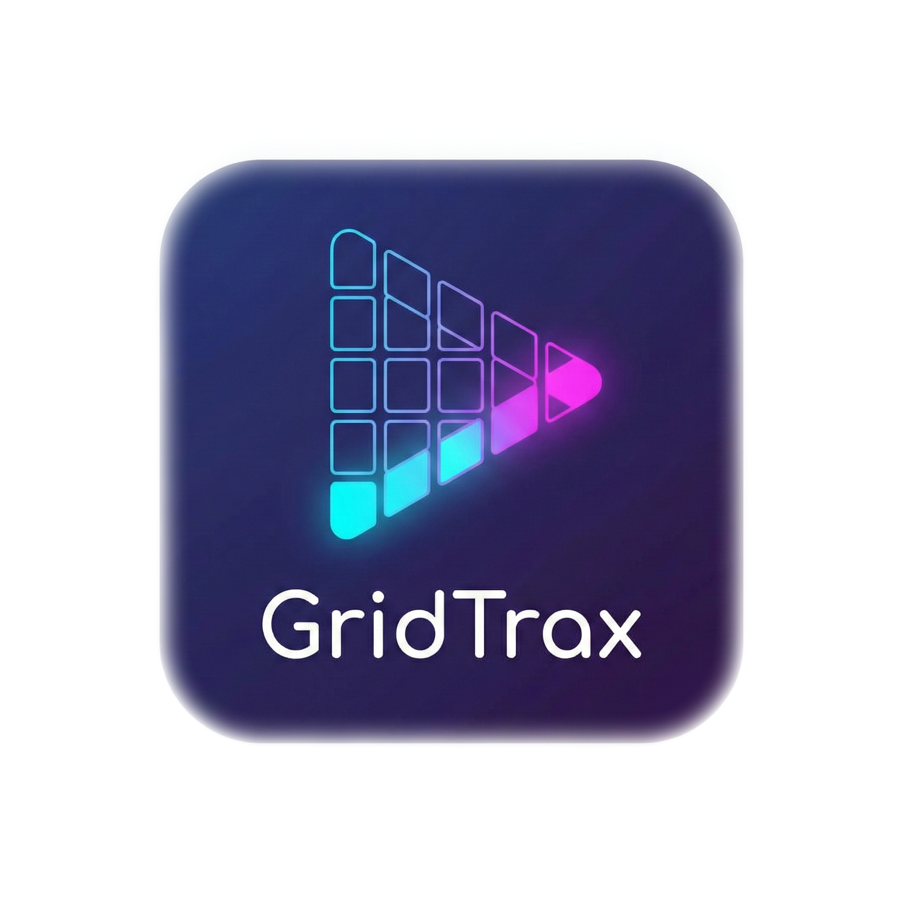

<div align="center">

# 🎬 GridTrax



**GridTrax** 是一个现代、精美且纯粹的前端私有影视剧集进度追踪应用。<br/>
不仅能像传统的看剧记录工具一样管理您的观影状态，还能以“网格化”（Grid）视图直观展示每一集的观看进度。

[](https://opensource.org/licenses/MIT)
[](https://react.dev/)
[](https://www.typescriptlang.org/)
[](https://vitejs.dev/)

</div>

---

## 🌟 项目动机

**GridTrax** 的核心灵感来源于广受好评的动漫二次元社区 [**Bangumi (番组计划)**](https://bgm.tv/)。

本项目作为一个轻量级的个人练习与自用工具，旨在探索一种不同的 UI 呈现方式与数据存储模式：

1. 🔲 **网格系统**：对于包含多季内容或数十集的剧集/动漫，尝试用直观的方块网格来分别呈现每一集的独立状态，像打卡一样记录单集看番进度。
2. 🚀 **纯前端架构**：由于仅作为个人记录工具，项目完全移除了后端服务依赖。所有的观影数据均保存在本地浏览器中。
3. 💾 **本地备份**：支持 JSON 文件导入导出，通过手动备份在不同浏览器或设备间迁移观影记录。

---

## ✨ 核心特性

- **明暗主题**：内置 Ocean、Dracula、TokyoNight 等暗色主题，以及 Sunlit Mint 明亮主题，可手动切换。
- **海量数据源支持**：集成 [TMDB API](https://www.themoviedb.org/)，提供极其丰富的全球影视/动漫元数据。
- **集数网格**：为每一季的每一个单集生成独立网格，长按/点击即可轻松打卡。
- **集数分页与排序**：正在追踪列表每页显示 18 集，支持上一页、下一页和正序/倒序排列。
- **手机标题列表**：接口返回有效单集短标题时，可在集数网格和标题列表之间切换。
- **数据备份**：仅保留 JSON 导入导出，导入前校验文件并确认覆盖，不包含账号信息或 API Token。
- **响应式设计**：流畅支持桌面端和移动端浏览的操作体验。

---

## 🛠️ 技术栈

| 类别       | 技术 / 框架 |
| ---------- | :--- |
| **框架**   | [React 19](https://react.dev/) + [TypeScript](https://www.typescriptlang.org/) |
| **构建**   | [Vite 7](https://vitejs.dev/) |
| **UI 组件** | [Material UI (MUI)](https://mui.com/) v7 |
| **状态管理**| [Zustand](https://zustand-demo.pmnd.rs/) (带 `persist` 持久化) |
| **网络请求**| `Axios` (TMDB) |

---

## Cloudflare Pages 部署

本项目是纯前端 SPA，当前仓库仅保留 Cloudflare Pages 部署配置。构建命令为 `npm run build`，静态产物输出到 `dist/`，无需额外后端服务。

### 1. 连接仓库并配置构建

在 [Cloudflare 控制台](https://dash.cloudflare.com/) 中创建 Pages 项目并连接自己的 Git 仓库，设置以下构建参数：

| 配置项 | 值 |
| --- | --- |
| 构建命令 | `npm run build` |
| 构建输出目录 | `dist` |
| 项目根目录 | 仓库根目录 |
| Node.js | 22.12.0 或更高版本 |

根目录的 `wrangler.jsonc` 已声明 `pages_build_output_dir` 为 `dist`，请保留该文件。

### 2. 配置 TMDB Token

准备好 TMDB 的 **API Read Access Token**，在 Pages 对应部署环境的构建环境变量中添加：

```env
VITE_TMDB_BEARER=your_tmdb_read_access_token
```

- 填写完整的 Read Access Token，不是 API Key；不要添加 `Bearer ` 前缀。
- 线上部署不需要提交 `.env.local`，直接使用 Pages 中配置的变量。
- 网页中没有 Token 设置入口，也不会读取旧版保存在浏览器中的 Token。
- 需要预览部署时，也应为对应环境配置该变量。

### 3. 构建与更新

保存配置并部署。之后更新代码或修改 `VITE_TMDB_BEARER` 时，需要重新构建部署；仅修改环境变量不会改变已经生成的前端文件。

> `VITE_` 变量会被嵌入浏览器可下载的前端代码，并非服务端秘密。请勿把 `.env.local` 或真实 Token 提交到公开仓库。如果文件已被 Git 跟踪，仅添加忽略规则不会让它退出版本管理。

---

## 本地开发与预览

本地开发用于修改和验证页面，不是额外的线上部署方式。使用 Node.js 22.12.0 或更高版本，在项目根目录安装依赖：

```bash
npm ci
```

在根目录创建仅供本机使用的 `.env.local`：

```env
VITE_TMDB_BEARER=your_tmdb_read_access_token
```

启动开发服务，访问终端输出的本地地址：

```bash
npm run dev
```

修改 `.env.local` 后需重启开发服务。检查生产构建并在本地预览：

```bash
npm run build
npm run preview
```

`preview` 当前配置端口为 `721`，实际地址以终端输出为准。它只用于本地检查构建产物，线上仍由 Cloudflare Pages 托管。

---

## JSON 数据备份

观影数据保存在当前浏览器的 LocalStorage 中。清除站点数据会删除记录，请定期导出备份。

1. 点击导航栏的 **数据备份** 图标（手机端在更多菜单中）。
2. 点击 **导出 JSON**，下载包含观影状态、评分、评论、单集进度及影片元数据的备份。
3. 点击 **导入 JSON**，选择文件并确认覆盖。导入会替换当前全部记录，不进行合并；取消或文件校验失败不会更改现有记录。
4. 支持旧版原始记录以及 v2/v3 备份，新备份格式为 v4。旧备份中的账号、Token 和第三方关联配置不会恢复，也不会进入新备份。

项目不再包含 Bangumi 集成、WebDAV 或后台自动同步。既有浏览器观影记录仍会保留，旧的独立配置缓存不再使用。

---

## 🗺️ 发展计划

- [ ] **拓展数据源支持**：计划新增对豆瓣（Douban）等网站的数据抓取与支持。
- [ ] **条目元数据管理**：支持手动校对条目的 TMDB ID 等核心元数据。
- [ ] **可视化观影档案**：支持导出美观、结构化的个人追剧足迹与可视化数据图表。

---

## 使用限制

- 搜索、详情和海报仍由浏览器直接请求 TMDB，静态部署不会自动代理这些请求。
- 不同设备和浏览器的本地记录互不共享，需要使用 JSON 文件手动迁移。

---

## 🤝 参与项目

欢迎任何形式的贡献！无论是一个小 Bug 的修复，还是全新特性的建议：

1. **Fork** 本仓库。
2. 创建您的 Feature 分支: `git checkout -b feature/AmazingFeature`。
3. 提交变更: `git commit -m 'Add some AmazingFeature'`。
4. 推送到分支: `git push origin feature/AmazingFeature`。
5. 提交一个 Pull Request。

建议在提大型 PR 前，先在 Issues 提出您的想法以供讨论。

---

## 🤖 AI声明

本项目几乎**全部**由 AI 进行辅助完成，使用到的模型包含 Google Gemini 3.1 系列与 Anthropic Claude 4.6 系列。

---

## 📄 开源协议

GridTrax 基于 [MIT License](LICENSE) 协议开源。请自由享受并改造它！
